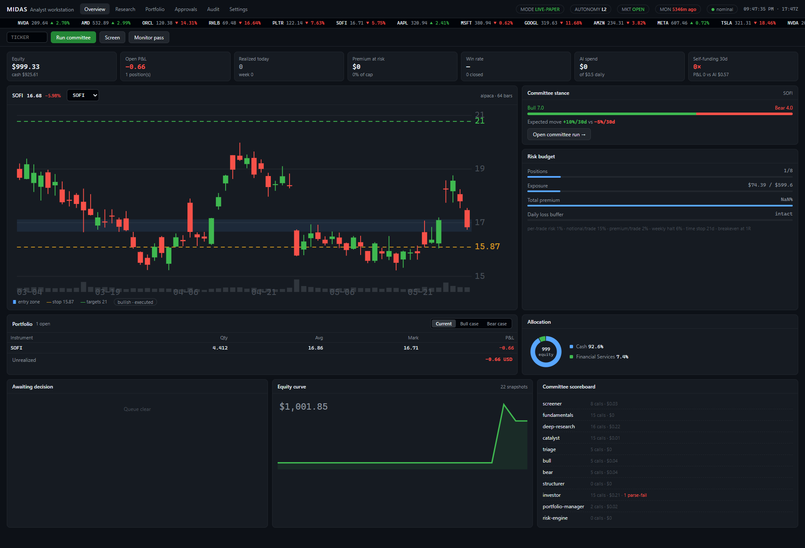
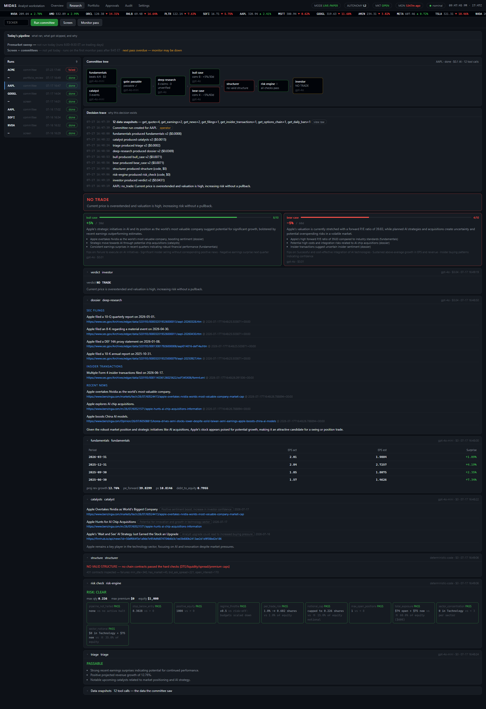

# Midas

[](https://github.com/Jamal-Akhras/Midas/actions/workflows/ci.yml)
[](https://github.com/Jamal-Akhras/Midas/actions/workflows/codeql.yml)
[](LICENSE)

A personal, single-user trading system with an audit trail, in two parts:

- **A rules-based core book.** A trend-filtered ETF allocation, rebalanced
  monthly, that the backtests in [docs/results.md](docs/results.md) say
  beats cash in every window tested with half the index's drawdown.
- **An LLM research committee.** Agents research candidates with real tools
  (market data, SEC EDGAR, news, web search), argue bull against bear on
  different providers, structure defined-risk option trades through
  deterministic code checks, and issue verdicts the operator approves. The
  same committee reads news and filings into sourced **event flags** that
  can veto a core slice, and every flag is scored against what the market
  did next.

Paper trading only. Everything is reconstructible months later from the
audit trail alone.



**This is decision-support tooling, not financial advice.** Single user,
own money, no public exposure.

## Read the results first

The committee's own rule set was backtested on twenty years of daily data
and ten years of 5-minute bars before anything here was trusted
([docs/results.md](docs/results.md), regenerated by `midas research report`;
the story is in [docs/writeup.md](docs/writeup.md)). The short version:

| 2004 to 2026 | CAGR | Sharpe vs cash | Max drawdown |
|---|---|---|---|
| Cash (3-month T-bill) | 1.7% | 0.00 | 0% |
| Buy and hold SPY | 10.6% | 0.54 | -55% |
| SPY above its 200-day average, else T-bills | 8.2% | 0.59 | -21% |
| The swing committee's deterministic skeleton | 6.2% | 0.44 | -40% |

Since 2022, with cash yielding 4%, the swing skeleton returned roughly
zero. An LSTM baseline predicted direction less accurately than "always
up". The best-documented intraday rule replicates gross but its whole edge
is about three basis points per trade, inside the spread. So the return
engine is the rules-based core book; the LLMs do what the evidence says
they are good at: reading documents into sourced, structured, scored data.

## Scope

- **Core book** (`CORE_ENABLED`): equal slices of `CORE_ALLOCATION_PCT` of
  equity across `CORE_UNIVERSE` (default SPY, QQQ, EFA, GLD, IEF), each
  held only while above its 200-day average, rebalanced monthly through
  the autonomy ladder. Off by default.
- **Swing committee**: long calls/puts and debit spreads, minimum 14 DTE
  at entry, defined risk only; share positions held weeks to months.
- **Event flags**: sourced, structured readings of news and filings;
  vetoes and a scored ledger, never entry signals.
- Daily bars and scheduled re-evaluations. Never tick-level speed.

## Quick start (zero keys, zero spend)

```bash
pip install -e ".[dev,research]"
midas init          # creates the sqlite ledger (Alembic-managed); demo mode auto-enables with no keys
midas screen        # screener scans the demo universe
midas run ACME      # full committee pipeline for one ticker
midas cycle         # screen, then committee on every candidate
midas approvals     # see the proposed thesis
midas approve <id>  # approve -> executes on the paper account
midas core plan     # what this month's core rebalance would do
midas core rebalance --force   # propose it now (L0) or execute it (L1+)
midas flags scan ACME          # event analyst -> sourced flags
midas positions     # open positions + account
midas monitor       # one scheduler pass (re-evaluations, marks, halts, core cadence)
midas stats         # track record vs the L3 bar, counterfactual and flag ledgers
midas audit         # the append-only audit trail
scripts\check.cmd   # positions + audit + stats to logs\checks\, then the Telegram brief (Windows)
midas brief --send --review   # the brief + a Claude review, to Telegram (see Operator notifications)
midas ui            # the Analyst Workstation: http://127.0.0.1:8420
midas research report --data data/daily.pkl   # rebuild docs/results.md (after `midas research fetch`)
pytest              # the whole suite runs offline in demo mode
```

Add real keys in `.env` (see `.env.example`) to leave demo mode. Any one
model key enables real AI; Alpaca/Finnhub/Brave keys enable real data.
Optionally put [Tollgate](docs/tollgate.md) in front of the model calls.

## The committee

| Stage | Actor | Kind |
|---|---|---|
| Universe screen | Screener Agent | LLM + market-data tools |
| Price/volume floors | code | deterministic |
| Setup gate | code | deterministic: the setup label checked against the technical block |
| Fundamentals | Earnings/Fundamentals Agent | LLM + earnings/estimates tools |
| Deep research | Deep Research Agent | LLM + EDGAR, insiders, web search, page fetch |
| Catalysts | Catalyst/News Agent | LLM + news/earnings tools |
| "Passable?" gate | code floors + cheap-model triage | mixed |
| Bull case / Bear case | two agents, **different providers, asserted at run time** | LLM |
| Evidence audit | code | deterministic: counts each side's evidence items that name their artifact |
| Option structure | code generates candidates -> LLM assist picks -> code re-validates | mixed |
| Risk & sizing | risk engine | **deterministic code only** |
| Verdict | Investor Agent (risk check is binding) | LLM, high-tier models |
| Verdict sanity | code: entry zone, stop, targets and reward-to-risk against the live quote | deterministic |
| Execution | paper broker + execution-time risk re-check | code |
| Stop layer | code: disaster floor at once; ordinary breaches wait out the opening guard and need consecutive passes | deterministic |
| Premarket gap review | Investor Agent, premarket, with news: hold, exit at the open, or raise the stop | LLM, bounded by code |
| Re-evaluation | Investor Agent on schedule + events (earnings within 7 days, DTE decay) | LLM + tools |
| Portfolio review | Portfolio Manager Agent at a fixed time; cannot exit a fresh position on the facts it was opened on | LLM, guarded by code |
| Outcome scoring | code, graded by the market | deterministic |
| Event flags | Event Analyst: news and filings into sourced flags, scored against forward returns | LLM + tools, then code |

Honest-data rule: agents never state a number a tool did not return in that
conversation. Every dossier claim and every event flag carries a source
URL; unverifiable material lands in an explicit `unverified` list
(schema-enforced).

## Integrity gates (what the July 2026 audit trail taught)

- **Provider diversity is asserted, not assumed.** The routing table leads
  bull and bear with different providers, but fall-through once put both
  cases on the same model for twenty runs. The committee now reads which
  provider actually produced each case from the router's decision record
  and refuses the run if they match (`committee.provider_collision`). A
  single-provider setup can switch the refusal off; the collision is
  recorded either way.
- **Verdicts are checked against the live quote.** Entry zone within 15%
  of it, stop 2 to 25% beyond the entry on the thesis side, targets beyond
  the entry. A failing verdict is re-prompted once with the problems; a
  second failure ends the run with no thesis. The schema alone once let an
  entry zone of 135 to 145 through for a stock trading at 347.
- **Two cost ledgers.** Behind a gateway, the gateway's charge is stored
  next to the router's own estimate and a `cost.divergence` event fires
  when they disagree, the same pattern used for fills (internal simulator
  against Alpaca).

See [docs/adr/](docs/adr/) for the reasoning behind each of these.

## Autonomy ladder

Promotion is a **manual config change** (`AUTONOMY_LEVEL`), never something
the system grants itself. The ladder applies to the core book and the
committee alike.

- **L0** (default): committee and core book propose; the operator approves everything.
- **L1**: approved theses and core plans auto-execute on PAPER; exits still proposed.
- **L2**: Investor Agent manages entries and exits on PAPER within hard caps.
- **L3+**: real money. **The code path does not exist in this codebase.**
  `AUTONOMY_LEVEL=3` fails validation on purpose. The bar before anyone
  writes it: >=30 days and >=20 closed paper positions at L2, positive
  expectancy with a bootstrap p-value, max drawdown inside the configured
  limit (`midas stats` reports progress). Changing any strategy-defining
  setting, prompt or routing restarts that clock.

## Operator notifications

`midas brief` turns the ledger into a short plain-text report: account and
day change, open positions, then everything since the last brief that an
operator should see, alerts first (a monitor heartbeat that stopped, mirror
mismatches, rejected orders, halts), then trades and committee decisions,
and the AI spend against the daily cap. `--send` posts it to a private
Telegram chat. `--review` first hands the brief and the full
`scripts\check.cmd` report to Claude Code's command line, run with every
tool disabled, for a few lines of independent review. No model is called
through the router and no order is placed. Setup is three steps: create a
bot with @BotFather, send it one message, run `midas notify setup --write`.
The scheduled check script then calls `midas brief --send --review` after
each report.
`--compact` is the hourly form used during the session: a status line,
positions on one line, only the sections with content, and the review
only when something needs attention. The scheduler sends full briefs at
09:00 and 19:05 local and compact ones hourly until the close.
Between briefs, each monitor pass ends with one short push listing that
pass's fills, stop exits, gap flags, portfolio-manager actions, approvals
and halts (`TELEGRAM_PUSH_EVENTS`); a quiet pass sends nothing.

## Risk rules (enforced in code, twice)

Per-trade risk cap, option premium caps (per-trade and total open), max
open positions, sector concentration, minimum DTE, liquidity floors
(open interest, bid-ask spread), daily/weekly loss limits that **halt the
whole pipeline** (`midas halt --clear` is the only way back), and a daily
AI spend ceiling. All checks run at recommendation time and AGAIN at
execution time; the execution-time result is stored on the order. The core
book has its own cap (its allocation) and is invisible to the swing caps,
stops, time stops, reviews and statistics.

A shares verdict needs a first target at least `MIN_REWARD_TO_RISK` stop
distances from the entry. Stop-breach exits are code with an opening
guard: a breach past the disaster floor exits at once; an ordinary breach
in the first `STOP_OPENING_GUARD_MINUTES` only logs, and after that it must
hold on `STOP_CONFIRMATION_PASSES` consecutive passes. A model may raise a
stop, never cut it. The portfolio manager cannot exit a position younger
than `PM_EXIT_MIN_AGE_HOURS` unless a research artifact or event flag newer
than its entry exists.

## Research

`midas/research` is the backtesting toolkit behind `docs/results.md`:
aligned daily data with a local cache, a drift-between-rebalances
simulator with per-side costs, the strategy functions (trend filters, dual
momentum, risk parity, cross-sectional momentum), the swing committee's
deterministic clone, opening-range-breakout and intraday-momentum rules on
5-minute bars, and walk-forward parameter selection. The live core book
trades the same `tactical_sma` function the report measures, so
simulation and production cannot quietly diverge. Tests run on synthetic
series with known answers. Typed to the strict mypy profile.

```bash
midas research fetch                 # daily bars (yfinance) -> data/daily.pkl
midas research fetch-intraday --symbols SPY,QQQ   # Alpaca 5-minute bars -> data/intraday/
midas research report                # -> docs/results.md
```

## The Analyst Workstation

`midas ui` serves a local web console (loopback only by default, stdlib
server, zero extra dependencies) over the same audited code paths as the
CLI: overview with the committee stance and risk gauges, research runs
with the committee tree and decision trace, portfolio with bull/bear
projections, approvals (theses and core plans), and the filterable audit
ledger. Actions execute in background threads; the UI never bypasses
approvals, risk checks, or the autonomy ladder.



## Provenance

- `DataSnapshot`: every tool result, verbatim, linked to the artifact that consumed it.
- `ResearchArtifact`: every agent output and every core plan, versioned, with model and cost.
- `CostEvent`/`ModelCall`: write-ahead cost log; every prompt/response and
  the router's reasoning, including failed parses and tool-loop steps, plus
  the gateway's charge when one is in front of the vendors.
- `AuditEvent`: append-only ledger of every state transition.
- `TradeOutcome`, `ScreenCandidate`, `EventFlag`: every closed position
  scored against its thesis, every screened candidate and every event flag
  scored against forward returns. The eval harness, graded by the market.

## Engineering

- CI runs ruff (lint and format), mypy, and the suite with a coverage floor
  on Python 3.10, 3.12 and 3.13; CodeQL weekly; Dependabot for pip and
  Actions. `pre-commit install` runs the same tools locally.
- Schema changes are Alembic migrations (`midas/migrations`); `midas init`
  stamps fresh databases, adopts pre-Alembic ledgers and upgrades
  versioned ones. A test asserts the migration chain reproduces the models.
- `Dockerfile`: non-root, sqlite ledger on a mounted volume.
- Decisions are recorded in [docs/adr/](docs/adr/).

## Layout

```
midas/
  config.py        settings + risk caps + the L3 bar + core book settings
  models/          domain (runs, artifacts, snapshots, theses, orders,
                   positions, outcomes, event flags) + ops (cost, audit)
  migrations/      Alembic environment and versions
  providers/       router (tool loop, write-ahead logging, gateway ledger),
                   routing.yaml, anthropic/openai/gemini/demo providers
  tools/           market data (alpaca->yfinance->demo), EDGAR, earnings/news
                   (finnhub/fmp), web search/fetch, snapshot infrastructure
  agents/          schemas (validated outputs), defs (agents as data), prompts/
  risk/            deterministic risk engine, option structure checks,
                   verdict sanity checks
  pipeline/        screen, per-ticker committee (commit-per-stage, resume,
                   integrity gates), event scans
  strategy/        the core book (plan, ladder, execution)
  execution/       paper broker (sim + Alpaca mirror), executor (autonomy + re-checks)
  scheduler/       monitor loop (reviews, triggers, halts, core cadence, scoring)
  outcomes/        outcome scoring + stats vs the L3 bar; weekly digest
  research/        backtester, strategies, intraday rules, walk-forward, report
  ui/              the Analyst Workstation (stdlib web server + single-file UI)
  cli.py           the operator console
docs/              results.md (generated), writeup.md, tollgate.md, adr/
tests/             offline tests (demo mode, in-memory SQLite, synthetic series)
```

## Known limitations (honest list)

- The core book has backtest evidence and no live track record yet; the
  swing committee has one closed paper trade. `midas stats` says so.
- Demo option pricing is shape-realistic but value-synthetic; deep OTM
  spreads look unrealistically cheap in demo mode.
- Equity paper orders mirror to the real Alpaca paper account when keys
  are set; options fill on the internal simulator at live chain mids
  unless the account has options approval.
- `UNIVERSE=sp500` needs a constituent-list source; use a comma-separated
  `UNIVERSE`/`WATCHLIST` for now (`midas research fetch` scrapes the list
  for backtests only).
- Debit spreads are simulated as one net-debit instrument.
- Gemini cannot run behind the gateway (no wire format for it there).
- Cross-sectional backtests use today's S&P 500 constituents and carry
  survivorship bias; the results document labels every such row.

## Where an LLM adds value vs code (honest assessment)

LLMs: reading filings and news into sourced dossiers and event flags,
adversarial bull/bear argument, thesis articulation, re-evaluation
reasoning against a thesis. Deterministic code, and it stays code: the
return engine, screening floors, liquidity checks, position sizing,
premium caps, loss halts, structure validation, verdict sanity, fills,
outcome scoring. The backtests are the reason for that split.

## Licence

Apache-2.0. See [LICENSE](LICENSE).
